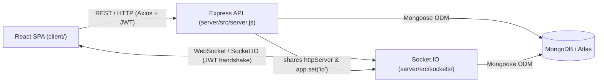

# CollabSync — Complete Project Guide & Viva Preparation

> This guide explains **every part of the CollabSync codebase** in plain English, based directly on the real files in this repository. Wherever a feature is planned in `CLAUDE.md` or partially prepared in code but not yet wired up or deployed, that is stated honestly.

---

## 1. What and Why

### What CollabSync Is
**CollabSync** is a real-time team collaboration platform (similar in concept to a simplified Slack or Microsoft Teams). Teams organize work inside **Workspaces**, chat inside topic **Channels**, broadcast **Announcements**, see who is **Online/Offline**, see **live typing indicators**, and receive **Notifications** both immediately (via WebSockets) and when they log back in (saved in MongoDB).

### The Problem It Solves
Teams often scatter conversations across personal messaging apps, emails, and spreadsheets. Important updates get buried under casual chat, and newcomers lack a single place to see project discussions. CollabSync solves this by:
- Separating conversations by **Workspace** (project/team) and **Channel** (topic like `#general` or `#design-review`).
- Separating urgent updates (**Announcements** with `low`, `normal`, `high` priority) from everyday chat (**Messages**).
- Enforcing **Role-Based Access Control (RBAC)** and **Membership Checks** so only authorized roles create structure/announcements and only workspace members read or post inside a workspace.

### Who Uses It & The Three Roles
Every user document in [`server/src/models/User.js`](../server/src/models/User.js) has a `role` field (`enum: ['admin', 'leader', 'member']`, default `'member'`). Public signup (`POST /api/auth/register` in [`server/src/controllers/authController.js`](../server/src/controllers/authController.js)) **always** creates a `'member'`; the first `'admin'` is promoted manually in MongoDB, and only an `'admin'` can change roles later via `PATCH /api/users/:id/role`.

| Role | What They Can Do in the Real Code | Where Enforced |
| :--- | :--- | :--- |
| **`member`** | Register/login, update own name (`PATCH /api/users/me`), view workspaces/channels/announcements they belong to, send & read channel messages, view/mark notifications as read. | `protect`, `checkWorkspaceMembership`, [`messageHandlers.js`](../server/src/sockets/messageHandlers.js) |
| **`leader`** | Everything a `member` can do, **plus** create workspaces (`POST /api/workspaces`), invite registered users to a workspace (`POST /api/workspaces/:id/members`), create channels (`POST /api/channels`), and post announcements (`POST /api/announcements`). | `authorize('admin', 'leader')` in backend routes; `canCreate` checks in [`Sidebar.jsx`](../client/src/components/Sidebar.jsx) and [`AnnouncementsPanel.jsx`](../client/src/components/AnnouncementsPanel.jsx) |
| **`admin`** | Everything a `leader` can do, **plus** access `/admin`, list all users (`GET /api/users`), and change any other user's role (`PATCH /api/users/:id/role` — cannot demote self). | `authorize('admin')` in [`userRoutes.js`](../server/src/routes/userRoutes.js); [`RoleRoute.jsx`](../client/src/components/RoleRoute.jsx) in [`App.jsx`](../client/src/App.jsx) |

### Core User Flow (Register to Posting an Announcement)
1. A new user opens `/register` ([`client/src/pages/Register.jsx`](../client/src/pages/Register.jsx)) and creates an account -> saved as `role: 'member'` with a hashed password, and receives a JWT token.
2. They are redirected to `/dashboard` ([`client/src/pages/Dashboard.jsx`](../client/src/pages/Dashboard.jsx)). On first login as a `'member'`, they see no workspaces until an `admin` or `leader` creates one and adds them.
3. An `admin` (promoted in MongoDB, or promoting a `leader` via `/admin` -> [`client/src/pages/AdminPage.jsx`](../client/src/pages/AdminPage.jsx)) clicks **Create Workspace** in [`Sidebar.jsx`](../client/src/components/Sidebar.jsx) -> backend creates the workspace **and** automatically creates a `#general` channel.
4. The `leader`/`admin` clicks **Add Member** (`AddMemberForm.jsx`), enters the member's registered email -> backend adds that user to `workspace.members` **and** all existing channels in that workspace.
5. Both users select `#general`, exchange real-time chat messages (via Socket.IO `sendMessage` / `receiveMessage`), and see live typing & online dots.
6. The `leader`/`admin` opens the **Announcements** panel ([`AnnouncementsPanel.jsx`](../client/src/components/AnnouncementsPanel.jsx)) and posts a high-priority announcement (`POST /api/announcements`) -> backend saves it, creates `Notification` documents for every workspace member, and emits `newAnnouncement` (showing a toast + updating the panel) and `newNotification` (incrementing the bell badge).

---

## 2. Architecture

### The Three Parts
1. **Frontend (`client/`)**: A React 19 Single Page Application (SPA) bundled by Vite 8 and styled with Tailwind CSS v4. It runs in the user's browser on port `5173` locally (or Nginx port `80` in Docker / Vercel CDN in production).
2. **Backend (`server/`)**: A Node.js + Express 5 + Socket.IO 4 server (`server/src/server.js`) listening on `process.env.PORT || 5000`. Express handles HTTP REST requests, and Socket.IO attaches to the same `http.Server` (`httpServer`) to handle persistent WebSocket connections.
3. **Database (MongoDB)**: Stores 6 collections (`users`, `workspaces`, `channels`, `messages`, `announcements`, `notifications`) accessed through Mongoose schemas in `server/src/models/`.

```
+-------------------------------------------------------------------+
|                     USER BROWSER (React SPA)                      |
|  client/src/  (Port 5173 dev / Nginx :80 Docker / Vercel prod)    |
|                                                                   |
|  - Axios HTTP Client (client/src/services/api.js + *Service.js)   |
|  - Socket.IO Client (client/src/context/SocketContext.jsx)        |
+-------------------------+--------------------+--------------------+
                          |                    |
        HTTP / REST JSON  |                    | Socket.IO (WebSocket)
        Bearer <JWT>      |                    | auth: { token: <JWT> }
                          v                    v
+-------------------------------------------------------------------+
|                 BACKEND SERVER (Node.js + Express)                |
|  server/src/server.js  (Port 5000 / Render prod)                  |
|                                                                   |
|  Express Middleware & Routes     | Socket.IO Server (sockets/)    |
|  - protect / authorize           | - socketAuthMiddleware         |
|  - checkWorkspaceMembership      | - rooms: user:id,              |
|  - controllers + express-validator|         workspace:id,          |
|  - errorMiddleware               |          channel:id            |
+----------------------------------+--------------------------------+
                                   |
                          Mongoose ODM
                                   v
+-------------------------------------------------------------------+
|                   DATABASE (MongoDB / Atlas)                      |
|  Collections: User, Workspace, Channel, Message,                  |
|               Announcement, Notification                          |
+-------------------------------------------------------------------+
```



### Why Both REST and Socket.IO Are Needed
- **REST (HTTP Request-Response)** is stateless and ideal for one-off actions with standard HTTP status codes (`200`, `201`, `400`, `401`, `403`, `404`): registering, logging in, fetching lists (workspaces, channels, past 50 messages, announcements, notifications, admin user list), creating workspaces/channels/announcements, inviting members, and updating roles or profile names.
- **Socket.IO (Persistent Bidirectional Connection)** keeps an open connection between browser and server so the server can **push** data instantly without the client refreshing or polling: real-time chat (`sendMessage` -> `receiveMessage`), typing indicators (`typing` / `stopTyping`), online/offline dots (`onlineStatus`), instant announcement updates (`newAnnouncement`), and live notification badges (`newNotification`).
- **Critical project rule**: As documented in `CLAUDE.md` and implemented in `client/src/hooks/useMessages.js` + `server/src/sockets/messageHandlers.js`, **there is no REST POST endpoint to send messages**. Messages are sent *only* via Socket.IO `sendMessage`, saved once in MongoDB inside `handleSendMessage`, and broadcast as `receiveMessage`. REST `GET /api/channels/:id/messages` only loads message history.

---

## 3. Tech Stack, One by One

> Note on package names: `server/package.json` uses **`bcryptjs`** (`^3.0.3`), a pure-JS implementation of bcrypt, imported as `const bcrypt = require('bcryptjs')` in `server/src/models/User.js`. Also, **Postman** has no saved files inside this repository — it is an external API tool used manually during testing alongside the project's Node test scripts (`server/test-phase2.js`, `test-phase3.js`, `test-phase4.js`, `test-regression.js`, `test-phase5-fixes.js`).

### 1. React (`react` `^19.3.1`)
- **What it is**: Component-based JavaScript library for building user interfaces.
- **Problem it solves**: Updates only changed parts of the UI smoothly when messages, notifications, or channels change without reloading the page.
- **Where used**: All `.jsx` files under `client/src/`, mounted in `client/src/main.jsx` (`createRoot(...)`) and `client/src/App.jsx`.
- **Why over alternatives (plain DOM JS / Angular)**: Less boilerplate than Angular and far easier to maintain complex reactive state (chat lists, modals, bell counts) than manual `document.querySelector` DOM manipulation.
- **Examiner Q&A**: *What does `<StrictMode>` in `client/src/main.jsx` do?* -> It runs extra development checks (like double-invoking certain hooks/effects) to catch impure side effects early; it has zero impact in production builds.

### 2. Vite (`vite` `^8.3.6`)
- **What it is**: Next-generation frontend development server and production bundler (`client/vite.config.js`).
- **Problem it solves**: Slow dev-server startup and slow rebuilds in large JavaScript apps.
- **Where used**: `client/package.json` scripts (`vite`, `vite build`, `vite preview`) and `client/vite.config.js` (`@vitejs/plugin-react`, `@tailwindcss/vite`).
- **Why over Create React App (CRA)**: CRA is deprecated and bundles everything through Webpack before serving; Vite uses native ES modules in dev for near-instant startup and Rollup/Rolldown under the hood for optimized `dist/` builds.
- **Examiner Q&A**: *Why do frontend environment variables start with `VITE_`?* -> Vite only exposes `VITE_*` variables to `import.meta.env` in browser code so server-only OS secrets cannot accidentally leak into the frontend bundle.

### 3. Tailwind CSS (`tailwindcss` & `@tailwindcss/vite` `^4.3.5`)
- **What it is**: Utility-first CSS framework (`bg-zinc-950`, `flex`, `rounded-xl`).
- **Problem it solves**: Writing and naming hundreds of separate CSS files while keeping spacing, colors, and dark mode consistent.
- **Where used**: Imported via `@import "tailwindcss";` in `client/src/index.css`, styled across every JSX component and `client/src/utils/uiHelpers.js` (`ROLE_BADGE_STYLES`, `PRIORITY_BADGE_STYLES`).
- **Why over Bootstrap / plain CSS**: Utility classes live right next to JSX, avoid unused CSS shipping to production, and let us craft a custom dark zinc/indigo SaaS theme rather than generic Bootstrap components.
- **Examiner Q&A**: *How is Tailwind integrated in Tailwind v4 here?* -> Through `@tailwindcss/vite` in `client/vite.config.js` and `@import "tailwindcss";` in `client/src/index.css` instead of an old `tailwind.config.js` PostCSS setup.

### 4. React Context API (`createContext`, `useContext`)
- **What it is**: Built-in React mechanism to share state across component trees without passing props down every level ("prop drilling").
- **Problem it solves**: Components like `Navbar`, `Sidebar`, `ChatWindow`, and `MessageList` all need the logged-in `user`, active `socket`, or `selectedWorkspace`.
- **Where used**: `client/src/context/AuthContext.jsx` (`useAuth`), `SocketContext.jsx` (`useSocket`), `WorkspaceContext.jsx` (`useWorkspace`).
- **Why over Redux**: CollabSync has 3 clean global domains (auth, socket connection, active workspace/channel). Context API avoids Redux's extra boilerplate, actions, reducers, and package weight while keeping state split by concern.
- **Examiner Q&A**: *When would you switch from Context API to Redux/Zustand?* -> When hundreds of components subscribe to one high-frequency changing store and fine-grained selectors are needed to avoid unnecessary tree re-renders.

### 5. `react-router-dom` (`^7.18.5`)
- **What it is**: Declarative client-side routing library for React SPAs.
- **Problem it solves**: Lets users visit `/login`, `/register`, `/dashboard`, `/profile`, `/admin`, `/forbidden` with back/forward browser history without requesting new HTML pages from a server.
- **Where used**: `BrowserRouter`, `Routes`, `Route`, `Navigate` in `client/src/App.jsx`; `Link`/`useNavigate`/`useLocation` in `Login.jsx`, `Register.jsx`, `Navbar.jsx`, `Sidebar.jsx`, `ProfilePage.jsx`, `AdminPage.jsx`, `ForbiddenPage.jsx`.
- **Why over manual `window.location` navigation**: Full page reloads via `window.location` wipe out React state and disconnect Socket.IO; React Router swaps views seamlessly inside the SPA.
- **Examiner Q&A**: *Why did we also need `client/vercel.json` and `client/nginx.conf` for React Router?* -> Because if a user hits refresh on `/admin`, the hosting server looks for a `/admin` file unless configured to rewrite all routes back to `/index.html`.

### 6. `axios` (`^1.21.1`)
- **What it is**: Promise-based HTTP client for browsers and Node.js.
- **Problem it solves**: Simplifies JSON parsing, error rejection on 4xx/5xx statuses, and centralized header/error logic across API calls.
- **Where used**: Instance created in `client/src/services/api.js` with request/response interceptors, imported by all 7 service files in `client/src/services/`.
- **Why over native `fetch()`**: `fetch()` does not reject Promises on HTTP `401`/`403`/`500` errors and has no built-in request/response interceptors; Axios handles both cleanly in `api.js`.
- **Examiner Q&A**: *What does the response interceptor in `client/src/services/api.js` do on `401`?* -> It clears `token` and `user` from `localStorage` and redirects to `/login` (if not already there).

### 7. `socket.io-client` (`^4.8.4`)
- **What it is**: Browser client library for Socket.IO.
- **Problem it solves**: Establishes and automatically reconnects persistent real-time connections with event names, rooms, acknowledgements, and auth payloads.
- **Where used**: `io(getSocketUrl(), { auth: { token } })` in `client/src/context/SocketContext.jsx`, consumed by `Sidebar.jsx`, `Dashboard.jsx`, `MembersList.jsx`, and the 4 hooks in `client/src/hooks/`.
- **Why over browser `WebSocket` API**: Native `WebSocket` lacks automatic reconnection, named events (`receiveMessage`), callback acknowledgements (`sendMessage` ack), and seamless fallback to HTTP long-polling on restrictive networks.
- **Examiner Q&A**: *How does `socket.io-client` authenticate with the server?* -> By sending `{ auth: { token } }` in the connection handshake options inside `SocketContext.jsx`.

### 8. Node.js (Node 20 in server Docker / Node 22 LTS in client Docker & CI)
- **What it is**: JavaScript runtime built on Chrome's V8 engine for running JS outside the browser.
- **Problem it solves**: Lets us build the backend API and real-time socket server in the same language (JavaScript) as the React frontend.
- **Where used**: Runs `server/src/server.js` (`npm start` -> `node src/server.js`) and executes Vite/ESLint build tools on `client/`.
- **Why over Python (Django/Flask) or PHP**: Node's event-driven non-blocking I/O model excels at thousands of concurrent idle WebSocket connections, and sharing JavaScript/JSON across frontend and backend speeds up development.
- **Examiner Q&A**: *Why is Node.js good for a real-time chat app?* -> Its single-threaded event loop handles many concurrent WebSocket events asynchronously without spawning a heavy OS thread per connected user.

### 9. Express (`^5.3.0`)
- **What it is**: Minimalist web framework for Node.js.
- **Problem it solves**: Organizes URL routing (`/api/workspaces`), HTTP method handlers (`GET`, `POST`, `PATCH`), JSON body parsing, and middleware chains cleanly.
- **Where used**: `const app = express()` in `server/src/server.js` and `express.Router()` across all 7 files in `server/src/routes/`.
- **Why over raw Node `http.createServer` (or heavy NestJS)**: Raw `http` requires manual URL parsing and routing switches; Express gives clean composable middleware with minimal overhead for a student/mid-scale project.
- **Examiner Q&A**: *What is the `next` function in Express middleware?* -> Calling `next()` passes control to the next matching middleware/route; calling `next(error)` jumps straight to `errorMiddleware`.

### 10. MongoDB (Docker `mongo:7` / MongoDB Atlas)
- **What it is**: Document-oriented NoSQL database storing BSON (JSON-like) documents inside collections.
- **Problem it solves**: Persists users, workspaces, channels, messages, announcements, and notifications permanently across server restarts.
- **Where used**: Connected via `MONGO_URI` in `server/src/config/db.js`.
- **Why over SQL (PostgreSQL / MySQL)**: Document structures map naturally to JavaScript objects and arrays (like `members: [ObjectId]` on `Workspace` and `Channel`), eliminating join tables for simple membership lists while still supporting references (`populate`).
- **Examiner Q&A**: *Does MongoDB enforce foreign keys automatically like SQL?* -> No; referential integrity and membership rules must be checked in application logic (which we do in `accessMiddleware.js` and controllers), though Mongoose `.populate()` resolves `ObjectId` references cleanly.

### 11. Mongoose (`^9.12.1`)
- **What it is**: Object Data Modeling (ODM) library for MongoDB and Node.js.
- **Problem it solves**: MongoDB itself is schemaless; Mongoose adds strict schemas, field validation, enums, indexes, lifecycle hooks (`pre('save')`), and `.populate()`.
- **Where used**: All 6 files in `server/src/models/` (`User`, `Workspace`, `Channel`, `Message`, `Announcement`, `Notification`) and queries in every controller/handler.
- **Why over the raw `mongodb` driver**: Raw driver skips schema validation, enum enforcement, password `pre('save')` hooks, and automatic `.populate('sender', 'name email')`.
- **Examiner Q&A**: *What does `.populate('sender', 'name email')` do in `messageController.js`?* -> It replaces the `sender` `ObjectId` with the referenced `User` document containing only `name` and `email` (plus `_id`).

### 12. `express-validator` (`^7.3.2`)
- **What it is**: Express validation middleware wrapping `validator.js`.
- **Problem it solves**: Rejects malformed input (invalid emails, short passwords, empty titles, invalid role/priority strings) before database writes happen.
- **Where used**: `body(...)` rules in `authRoutes.js`, `workspaceRoutes.js`, `channelRoutes.js`, `announcementRoutes.js`, `userRoutes.js`, checked via `validationResult(req)` in controllers.
- **Why over manual `if (!req.body.email.includes('@'))` checks**: Standardizes email/length/enum/trim validation and avoids bug-prone ad-hoc regexes.
- **Examiner Q&A**: *If `body('email').isEmail()` fails in `authRoutes.js`, does it stop the request automatically?* -> No! `body(...)` only collects errors onto `req`; the controller must call `validationResult(req)` and return `400` if `!errors.isEmpty()`.

### 13. `jsonwebtoken` / JWT (`^9.0.3`)
- **What it is**: Library to sign and verify cryptographically signed JSON Web Tokens.
- **Problem it solves**: HTTP is stateless—once logged in, the client needs proof of identity on every future REST request and Socket.IO handshake.
- **Where used**: Signed in `server/src/utils/generateToken.js` (`jwt.sign({ id, role }, process.env.JWT_SECRET, { expiresIn: '7d' })`), verified in `server/src/middleware/authMiddleware.js` and `server/src/sockets/middleware/socketAuth.js`.
- **Why over server-side Sessions (cookies + Redis/memory store)**: JWT is stateless—the backend does not store active session rows in memory or DB, making horizontal scaling and cross-origin Vercel-to-Render requests straightforward.
- **Examiner Q&A**: *Is a JWT encrypted so nobody can read `{ id, role }`?* -> No! Standard JWT payload is Base64URL-encoded (readable by anyone), **not** encrypted; the signature guarantees nobody can *forge or alter* it without `JWT_SECRET`.

### 14. `bcrypt` (`bcryptjs` `^3.0.3`)
- **What it is**: Slow, salted password-hashing library.
- **Problem it solves**: Ensures database leaks never expose plain-text passwords.
- **Where used**: `userSchema.pre('save')` (`bcrypt.genSalt(10)`, `bcrypt.hash(...)`) and `userSchema.methods.matchPassword` (`bcrypt.compare(...)`) in `server/src/models/User.js`.
- **Why over plain hashing (SHA-256 / MD5)**: Plain hashes like SHA-256 are designed to be ultra-fast (billions of guesses per second on GPUs) and lack automatic per-user random salts against rainbow tables; bcrypt adds a unique random salt and a tunable work factor (`10` rounds).
- **Examiner Q&A**: *Why does `User.js` check `if (!this.isModified('password')) return;` in `pre('save')`?* -> Otherwise updating a user's `name`, `role`, or `status` (`online`/`offline`) would double-hash the already hashed password and lock them out!

### 15. Socket.IO (`socket.io` `^4.8.4`)
- **What it is**: Real-time bidirectional event engine running on the backend Node server.
- **Problem it solves**: Broadcasts messages, typing events, online status, announcements, and notifications instantaneously to specific users, workspaces, or channels.
- **Where used**: Initialized in `server/src/sockets/index.js` (`initializeSocket(httpServer)`), attached to Express via `app.set('io', io)` in `server/src/server.js`, and used across `sockets/*`, `announcementController.js`, and `notificationHelper.js`.
- **Why over plain `ws` (WebSocket library)**: Built-in **Rooms** (`io.to('channel:' + id).emit(...)`), **handshake middleware** (`io.use(socketAuthMiddleware)`), **acknowledgement callbacks**, and automatic transport negotiation.
- **Examiner Q&A**: *How does a REST controller like `createAnnouncement` emit a Socket.IO event?* -> `server.js` runs `app.set('io', io)`, and `announcementController.js` retrieves it with `const io = req.app.get('io')`.

### 16. `cors` (`^2.8.6`)
- **What it is**: Express middleware setting Cross-Origin Resource Sharing (`Access-Control-Allow-*`) HTTP headers.
- **Problem it solves**: Browsers block `http://localhost:5173` (or `*.vercel.app`) from calling APIs on `http://localhost:5000` (or `*.onrender.com`) unless the backend explicitly permits that origin.
- **Where used**: `app.use(cors({ origin: process.env.CLIENT_URL }))` in `server/src/server.js`, plus Socket.IO's `cors: { origin: process.env.CLIENT_URL, methods: ['GET', 'POST'], credentials: true }` in `server/src/sockets/index.js`.
- **Why over `origin: '*'`**: Restricting `origin` to `process.env.CLIENT_URL` prevents arbitrary third-party websites from making browser API calls against your backend.
- **Examiner Q&A**: *Is CORS enforced by Express or by the Browser?* -> The server sends `Access-Control-Allow-Origin` headers, and **the browser** blocks JS from reading responses if the origin doesn't match (`curl` and Postman ignore CORS).

### 17. `dotenv` (`^18.0.10`)
- **What it is**: Loads key-value pairs from a `.env` file into `process.env`.
- **Problem it solves**: Keeps secrets (`MONGO_URI`, `JWT_SECRET`, `CLIENT_URL`, `PORT`) out of Git source code while differing across local dev, Docker, and Render.
- **Where used**: `dotenv.config();` on line 20 of `server/src/server.js`; templates provided in `.env.example` and `server/.env.example`.
- **Why over hardcoding strings**: Hardcoded secrets in Git expose databases and let attackers forge admin JWTs.
- **Examiner Q&A**: *Do we need `dotenv` on Render or Docker Compose?* -> No, Render injects dashboard env vars and Docker Compose injects `environment:` directly into `process.env`; `dotenv.config()` safely skips if no `.env` file is present.

### 18. `nodemon` (`^3.1.14`)
- **What it is**: Development utility that watches server files and restarts Node automatically on save.
- **Problem it solves**: Avoids manually pressing `Ctrl+C` and re-running `node src/server.js` after every backend edit.
- **Where used**: `"dev": "nodemon src/server.js"` in `server/package.json` (`devDependencies`).
- **Why over `node --watch` / `pm2`**: `nodemon` is the classic zero-config dev watcher (`npm run dev`), while production containers use lightweight `node src/server.js` (`npm start`) without file-watching overhead.
- **Examiner Q&A**: *Why is `nodemon` in `devDependencies` instead of `dependencies`?* -> Production builds (`server/Dockerfile` runs `npm ci --omit=dev`) shouldn't install or run file watchers.

### 19. Docker & `docker-compose`
- **What they are**: Docker packages an app + runtime + dependencies into isolated containers; `docker-compose.yml` defines and networks multiple containers together (`mongo`, `server`, `client`).
- **Problem they solve**: "It works on my machine" — anyone can run the entire 3-tier stack cleanly with one command (`docker compose up --build`).
- **Where used**: `docker-compose.yml`, `server/Dockerfile`, `server/.dockerignore`, `client/Dockerfile`, `client/.dockerignore`.
- **Why over installing Mongo + Node globally on every laptop**: Isolates exact Node versions (`node:20-alpine` / `node:22-alpine`) and MongoDB 7 without polluting the host OS or touching the Atlas production DB.
- **Examiner Q&A**: *What happens in `docker-compose.yml` if `JWT_SECRET` is empty?* -> Compose immediately aborts with an error because of `${JWT_SECRET:?JWT_SECRET is missing or empty...}`.

### 20. Nginx (`nginx:alpine` in `client/Dockerfile`)
- **What it is**: High-performance web server & static file server.
- **Problem it solves**: Serves the compiled `client/dist/` static HTML/JS/CSS files inside Docker and rewrites React Router paths to `/index.html`.
- **Where used**: Stage 2 of `client/Dockerfile` and `client/nginx.conf` (`try_files $uri $uri/ /index.html;`).
- **Why over running `vite preview` or `vite dev` in production**: Dev servers are not built for production concurrency/caching, whereas Nginx serves static assets with tiny memory footprint (~few MB).
- **Examiner Q&A**: *Why can't Nginx just use default settings for a React Router app?* -> Default Nginx returns `404 Not Found` if a user refreshes `/admin` because no `/admin.html` file exists in `/usr/share/nginx/html`.

### 21. GitHub Actions (`.github/workflows/ci.yml`)
- **What it is**: Continuous Integration (CI) automation hosted inside GitHub.
- **Problem it solves**: Automatically catches syntax/lint errors and broken Vite builds on every push to `main` before broken code reaches users.
- **Where used**: `.github/workflows/ci.yml` — sets up Node `^22.13.0`, runs `npm ci`, `npm run lint`, and `npm run build` in `client/`, `npm ci` in `server/`, and optionally triggers `RENDER_DEPLOY_HOOK_URL`.
- **Why over manual local checks**: Guarantees clean installs from `package-lock.json` (`npm ci`) on a fresh Linux runner (`ubuntu-latest`) rather than trusting a developer's local `node_modules`.
- **Examiner Q&A**: *Why does CI use `npm ci` instead of `npm install`?* -> `npm ci` installs exact locked versions from `package-lock.json` cleanly without modifying the lockfile.

### 22. Vercel, Render, and MongoDB Atlas (Production Hosting)
- **What they are**: Managed cloud platforms — **Vercel** serves the static React frontend over a global CDN (`client/vercel.json`); **Render** runs the persistent Node/Express/Socket.IO server (`npm start` in `server/`); **MongoDB Atlas** hosts the cloud MongoDB database.
- **Problem they solve**: Put the app on public HTTPS/WSS URLs without managing Linux VMs or database backups yourself.
- **Why chosen together (e.g., Render over Vercel for the backend)**: Vercel Functions are serverless and terminate shortly after HTTP responses, which breaks persistent Socket.IO WebSocket connections; Render Web Services run a long-lived Node process ideal for Socket.IO.
- **Current status**: Config files (`client/vercel.json`, `.github/workflows/ci.yml`, `server.js` `process.env.PORT`) are ready in the repo, while actual cloud deployment on Render/Vercel/Atlas is still pending manual setup.
- **Examiner Q&A**: *Why can't you host the Socket.IO server on Vercel Serverless?* -> Serverless functions spin down after each HTTP call and cannot maintain long-lived stateful Socket.IO room subscriptions.

### 23. Postman (External Testing Tool)
- **What it is**: GUI HTTP/WebSocket client for sending custom requests (`POST`, `GET`, `PATCH`) with JSON bodies and Bearer tokens.
- **Problem it solves**: Lets developers test backend endpoints (`401`, `403`, `400` validation) before or independently of the React UI.
- **Where used in repo**: No Postman collection file (`.json`) is committed inside this repository; manual API verification is documented in root markdown files (such as `PHASE2-MANUAL-TESTS.md`) and automated Node scripts (`server/test-phase2.js`, `test-phase3.js`, `test-phase4.js`, `test-regression.js`, `test-phase5-fixes.js`).
- **Examiner Q&A**: *How do you pass a JWT in Postman to test `GET /api/auth/me`?* -> Under the `Authorization` tab choose `Bearer Token` and paste the `token` returned by `POST /api/auth/login`.

---

## 4. File-by-File Overview

### Full Folder Tree (Non-Ignored Files)
> Note: `CLAUDE.md` originally planned a `client/src/routes/` folder, **which does not exist in the codebase**. Routing lives directly in [`client/src/App.jsx`](../client/src/App.jsx) using [`ProtectedRoute.jsx`](../client/src/components/ProtectedRoute.jsx) and [`RoleRoute.jsx`](../client/src/components/RoleRoute.jsx), and shared formatting helpers live in `client/src/utils/uiHelpers.js`.

```text
CollabSync/
├── .env.example                 # Template env vars for docker-compose (JWT_SECRET, CLIENT_URL)
├── .gitignore                   # Root Git exclusions (.env, node_modules, dist, logs, .vscode)
├── CLAUDE.md                    # Authoritative project instructions, conventions & phase rules
├── docker-compose.yml           # Orchestrates mongo:7, server (:5000), and client (:5173)
├── .github/workflows/ci.yml     # GitHub Actions CI: client lint/build, server npm ci, Render hook
│
├── client/                      # React + Vite + Tailwind CSS v4 frontend
│   ├── .dockerignore            # Excludes node_modules, .env, dist from Docker build context
│   ├── .gitignore               # Client Git exclusions
│   ├── Dockerfile               # 2-stage build: Node 22 builder -> Nginx Alpine static server
│   ├── nginx.conf               # SPA try_files fallback to /index.html on port 80
│   ├── vercel.json              # Vercel rewrite rule sending all routes to /index.html
│   ├── package.json             # Client dependencies (React 19, Vite 8, Tailwind 4, Axios, etc.)
│   ├── vite.config.js           # Vite plugins: react() and tailwindcss()
│   ├── eslint.config.js         # ESLint flat rules for React hooks & refresh
│   ├── index.html               # HTML shell (<html class="dark">) mounting /src/main.jsx
│   └── src/
│       ├── main.jsx             # React entry mounting <App /> inside <StrictMode>
│       ├── App.jsx              # BrowserRouter, AuthProvider, SocketProvider, and all Routes
│       ├── index.css            # Tailwind v4 import, @theme fonts, dark scrollbars, slide-in anim
│       ├── App.css              # Comment pointing to index.css (kept minimal)
│       ├── utils/uiHelpers.js   # Badge styles (role/priority), getInitials(), extractApiError()
│       ├── services/
│       │   ├── api.js                 # Axios baseURL, Bearer token request & 401 response interceptors
│       │   ├── authService.js         # registerUser, loginUser, getCurrentUser
│       │   ├── workspaceService.js    # getWorkspaces, createWorkspace, addMemberToWorkspace
│       │   ├── channelService.js      # getWorkspaceChannels, createChannel
│       │   ├── messageService.js      # getChannelMessages(channelId, limit, before)
│       │   ├── announcementService.js # getWorkspaceAnnouncements, createAnnouncement
│       │   ├── notificationService.js # getNotifications, getUnreadCount, markNotificationAsRead
│       │   └── userService.js         # getAllUsers, updateUserRole, updateOwnProfile
│       ├── context/
│       │   ├── AuthContext.jsx        # Holds user/token in React state + localStorage; auth actions
│       │   ├── SocketContext.jsx      # Connects/disconnects socket.io-client with JWT auth token
│       │   └── WorkspaceContext.jsx   # Holds workspaces, channels, selectedWorkspace/Channel
│       ├── hooks/
│       │   ├── useMessages.js         # Joins channel room, loads REST history, listens receiveMessage
│       │   ├── useAnnouncements.js    # Loads REST announcements, listens newAnnouncement
│       │   ├── useNotifications.js    # Loads REST notifications/count, listens newNotification
│       │   └── useTypingIndicator.js  # Debounces typing emit (2s) & auto-clears remote users (3s)
│       ├── pages/
│       │   ├── Login.jsx              # Email/password login form -> /dashboard
│       │   ├── Register.jsx           # Name/email/password signup form -> /dashboard
│       │   ├── Dashboard.jsx          # WorkspaceProvider + Navbar + Sidebar + WorkspaceView + Toasts
│       │   ├── WorkspaceView.jsx      # Empty/channel-picker/ChatWindow + responsive AnnouncementsPanel
│       │   ├── ProfilePage.jsx        # Edit own display name + read-only email/role/status + logout
│       │   ├── AdminPage.jsx          # Admin user search, stats cards, role assignment table
│       │   └── ForbiddenPage.jsx      # 403 Access Denied fallback page
│       └── components/
│           ├── ProtectedRoute.jsx       # Redirects unauthenticated users to /login
│           ├── RoleRoute.jsx            # Redirects unauthorized roles to /forbidden
│           ├── Navbar.jsx               # Top bar: brand, route links, Live dot, NotificationBell, logout
│           ├── Sidebar.jsx              # Workspaces & channels lists, role-gated create/invite modals
│           ├── ChatWindow.jsx           # Channel header, MessageList, MessageInput, MembersList drawer
│           ├── MessageList.jsx          # Chronological bubbles, timestamps, TypingIndicator, auto-scroll
│           ├── MessageInput.jsx         # 2000-char textarea, Enter to send, typing event triggers
│           ├── TypingIndicator.jsx      # Animated dots + "X is typing..." text
│           ├── MembersList.jsx          # Member avatars, roles, live online/offline status dots
│           ├── AnnouncementsPanel.jsx   # Lists announcements & toggles CreateAnnouncementForm
│           ├── CreateAnnouncementForm.jsx # Form with title, content, low/normal/high priority
│           ├── NotificationBell.jsx     # Bell icon + unread count badge + toggles dropdown
│           ├── NotificationDropdown.jsx # Notification feed with relative times & "Read" buttons
│           ├── CreateWorkspaceModal.jsx # Modal form to create a workspace (+ #general on backend)
│           ├── CreateChannelModal.jsx   # Modal form to create a lowercase channel
│           ├── AddMemberForm.jsx        # Modal form to add existing user by email
│           ├── Modal.jsx                # Reusable backdrop + Escape-key accessible modal wrapper
│           └── Toast.jsx                # Toast & ToastContainer auto-dismissing notifications
│
└── server/                      # Node.js + Express 5 + Mongoose + Socket.IO backend
    ├── .dockerignore            # Excludes node_modules, .env, dist from Docker context
    ├── .env.example             # Template PORT, MONGO_URI, JWT_SECRET, CLIENT_URL
    ├── Dockerfile               # Node 20 Alpine runtime with npm ci --omit=dev
    ├── package.json             # Dependencies + start/dev scripts (server entry: src/server.js)
    └── src/
        ├── server.js            # Express app, CORS, REST route mounts, Socket.IO init, listen()
        ├── config/db.js         # Mongoose connectDB() with exit(1) on failure
        ├── models/              # Mongoose schemas: User, Workspace, Channel, Message, Announcement, Notification
        ├── middleware/
        │   ├── authMiddleware.js    # protect (JWT check) & authorize(...roles)
        │   ├── accessMiddleware.js  # isValidObjectId, checkWorkspaceMembership, checkChannelAccess
        │   └── errorMiddleware.js   # Central CastError + statusCode JSON error formatter
        ├── routes/              # auth, workspace, channel, message, announcement, notification, user
        ├── controllers/         # Request validation + business logic for all 7 domains
        ├── utils/
        │   ├── generateToken.js       # Signs 7-day JWT with { id, role }
        │   └── notificationHelper.js  # Creates/emits Message notifications for offline members
        └── sockets/
            ├── index.js             # Initializes Socket.IO, CORS, auth middleware, event listeners
            ├── middleware/socketAuth.js # Verifies handshake JWT & loads User onto socket
            ├── roomHandlers.js      # joinWorkspace & joinChannel (with membership checks)
            ├── messageHandlers.js   # sendMessage -> validate, save Message, emit receiveMessage
            ├── typingHandlers.js    # typing & stopTyping channel broadcasts (excluding sender)
            └── statusHandlers.js    # Marks online/offline in DB & broadcasts onlineStatus
```

### Detailed Reference of Core Files

| File | Contains & Exports | Called / Used By | If Deleted, What Breaks? |
| :--- | :--- | :--- | :--- |
| [`server/src/server.js`](../server/src/server.js) | Creates Express `app` & `httpServer`, configures CORS/JSON, mounts all REST routers + `/api/health`, initializes Socket.IO, starts listening. (Entrypoint script, no exports.) | Started by `npm start` / `npm run dev` | Entire backend refuses to start; zero REST or Socket.IO endpoints exist. |
| [`server/src/models/User.js`](../server/src/models/User.js) | `User` schema, bcrypt `pre('save')` password hashing, `matchPassword()`, `toJSON()` password stripper. Exports Mongoose `User` model. | `authController`, `workspaceController`, `userController`, `socketAuth`, `statusHandlers`, `notificationHelper` | Login, registration, admin user list, password hashing, and presence all fail. |
| [`server/src/middleware/authMiddleware.js`](../server/src/middleware/authMiddleware.js) | Exports `{ protect, authorize }`. Decodes `Authorization: Bearer <token>` and checks `req.user.role`. | Every protected route file + `server.js` | Every private API loses authentication and role checks (`ReferenceError` on server startup). |
| [`server/src/sockets/index.js`](../server/src/sockets/index.js) | Exports `initializeSocket(httpServer)`. Applies `socketAuthMiddleware`, joins `user:<id>`, wires 6 socket events. | `server.js` (`startServer`) | All real-time chat, typing, presence, and live notifications stop working. |
| [`client/src/App.jsx`](../client/src/App.jsx) | Wraps app in `BrowserRouter`, `AuthProvider`, `SocketProvider` and defines all 7 routes. Exports default `App`. | `client/src/main.jsx` | Blank screen; zero client routing or global auth/socket providers. |
| [`client/src/services/api.js`](../client/src/services/api.js) | Exports configured `axios` instance `api` with JWT request interceptor & 401 redirect response interceptor. | All 7 domain `*Service.js` files | Every frontend REST API call breaks and JWT tokens stop being sent. |
| [`client/src/context/AuthContext.jsx`](../client/src/context/AuthContext.jsx) | Exports `AuthProvider`, `useAuth`. Manages `user`, `token`, `login`, `register`, `logout`, `refreshUser`. | `App.jsx`, `ProtectedRoute`, `RoleRoute`, `Login`, `Register`, `Navbar`, `Sidebar`, `ProfilePage`, `AdminPage`, `MessageList`, `AnnouncementsPanel`, `useNotifications`, `SocketContext` | Authentication breaks app-wide; components throw `useAuth must be used within AuthProvider`. |
| [`client/src/context/SocketContext.jsx`](../client/src/context/SocketContext.jsx) | Exports `SocketProvider`, `useSocket`. Manages live `socket` and `isConnected`. | `App.jsx`, `Navbar`, `Sidebar`, `Dashboard`, `MembersList`, `useMessages`, `useAnnouncements`, `useNotifications`, `useTypingIndicator` | Real-time connection vanishes; all hooks calling `useSocket()` crash. |

---

## 5. Backend in Depth

### Server Startup Order (`server/src/server.js`)
The startup sequence matters because middleware runs top-to-bottom and Socket.IO needs the DB ready before accepting connections:

```js
dotenv.config();                      // 1. Load .env into process.env
const app = express();
const httpServer = http.createServer(app); // 2. Raw HTTP server shared by Express & Socket.IO

app.use(cors({ origin: process.env.CLIENT_URL })); // 3. CORS before routes
app.use(express.json());              // 4. Parse JSON request bodies into req.body
// 5. Mount GET /api/health + /api/* routers
app.use(errorMiddleware);             // 6. Error handler MUST be mounted LAST

const startServer = async () => {
  await connectDB();                  // 7. Connect MongoDB first (exits if fails)
  const io = initializeSocket(httpServer); // 8. Attach Socket.IO to httpServer
  app.set('io', io);                  // 9. Share io with REST controllers (announcements)
  httpServer.listen(process.env.PORT || 5000); // 10. Open port
};
```

### Database Connection (`server/src/config/db.js`)
Calls `await mongoose.connect(process.env.MONGO_URI)`. If MongoDB is unreachable or `MONGO_URI` is invalid, the `catch` block logs the error and calls `process.exit(1)` so Docker/Render knows startup failed instead of running a broken server.

### Every Mongoose Model & Why Each Field Exists

1. **`User` ([`User.js`](../server/src/models/User.js))**:
   - `name` (String, required, trimmed) — Display name shown in chat bubbles, member lists, and navbar.
   - `email` (String, required, `unique: true`, `lowercase: true`, trimmed) — Unique login & workspace-invite identifier.
   - `password` (String, required, `minlength: 6`) — Stored as a bcrypt hash, stripped from JSON via `toJSON()`.
   - `role` (`'admin' | 'leader' | 'member'`, default `'member'`) — Controls RBAC permissions.
   - `status` (`'online' | 'offline'`, default `'offline'`) — Persisted online presence updated on socket connect/disconnect so offline users still receive DB notifications.
   - `timestamps: true` — Auto-adds `createdAt` & `updatedAt`.
2. **`Workspace` ([`Workspace.js`](../server/src/models/Workspace.js))**:
   - `name` (String, required, trimmed), `description` (String, default `''`).
   - `owner` (`ObjectId` -> `User`, required) — Creator of the workspace.
   - `members` (`[ObjectId]` -> `User`) — Array used by every workspace/channel membership check.
   - `timestamps: true`.
3. **`Channel` ([`Channel.js`](../server/src/models/Channel.js))**:
   - `name` (String, required, trimmed; normalized lowercase in `channelController.js`).
   - `workspace` (`ObjectId` -> `Workspace`, required), `createdBy` (`ObjectId` -> `User`, required).
   - `members` (`[ObjectId]` -> `User`) — Automatically synced with `workspace.members` on channel creation and when new members join the workspace.
   - **Compound Unique Index**: `channelSchema.index({ name: 1, workspace: 1 }, { unique: true })` prevents two `#general` channels in the *same* workspace while allowing `#general` in *different* workspaces.
4. **`Message` ([`Message.js`](../server/src/models/Message.js))**:
   - `channel` (`ObjectId` -> `Channel`, required), `sender` (`ObjectId` -> `User`, required).
   - `content` (String, required, trimmed, `maxlength: 2000`).
   - **Index**: `messageSchema.index({ channel: 1, createdAt: -1 })` speeds up fetching the latest 50 messages for a channel.
5. **`Announcement` ([`Announcement.js`](../server/src/models/Announcement.js))**:
   - `workspace` (`ObjectId` -> `Workspace`, required), `title` (String, required, trimmed), `content` (String, required, trimmed).
   - `priority` (`'low' | 'normal' | 'high'`, default `'normal'`), `author` (`ObjectId` -> `User`, required).
   - **Index**: `{ workspace: 1, createdAt: -1 }`.
6. **`Notification` ([`Notification.js`](../server/src/models/Notification.js))**:
   - `recipient` (`ObjectId` -> `User`, required), `type` (`'message' | 'announcement'`, required), `message` (String, required), `isRead` (Boolean, default `false`).
   - Optional reference links: `relatedAnnouncement`, `relatedMessage`, `relatedChannel`.
   - **Index**: `{ recipient: 1, isRead: 1, createdAt: -1 }` optimizes both unread counts and notification dropdown fetches.

### Middleware, Routes & Controllers Summary
- **`protect`** ([`authMiddleware.js`](../server/src/middleware/authMiddleware.js)): Verifies Bearer JWT, sets `req.user = { id: decoded.id, role: decoded.role }` or returns `401`.
- **`authorize(...roles)`** ([`authMiddleware.js`](../server/src/middleware/authMiddleware.js)): Checks `roles.includes(req.user.role)` or returns `403`.
- **`checkWorkspaceMembership`** & **`checkChannelAccess`** ([`accessMiddleware.js`](../server/src/middleware/accessMiddleware.js)): Validate ObjectId (`400`), check doc existence (`404`), verify user is in `workspace.members` (`403`). *(Note: `checkWorkspaceMembership` is used on `GET /api/workspaces/:id/channels` and `GET /api/workspaces/:id/announcements`, while `channelController`, `messageController`, `announcementController`, and `workspaceController` also perform membership checks inline; `checkChannelAccess` is defined and exported in `accessMiddleware.js` though `messageRoutes.js` calls `getChannelMessages` directly where membership is checked inline.)*
- **Validation**: Route files define `express-validator` arrays (`registerValidation`, `createWorkspaceValidation`, etc.), and controllers inspect `validationResult(req)` returning `400 { errors: errors.array() }`. *(Notice the slight shape difference from `CLAUDE.md`'s planned `{ message: 'Validation failed', errors: [...] }` — [`uiHelpers.js`](../client/src/utils/uiHelpers.js) `extractApiError` handles both via `err?.response?.data?.errors?.[0]?.msg || err?.response?.data?.errors?.[0]?.message`!)*
- **`errorMiddleware`** ([`errorMiddleware.js`](../server/src/middleware/errorMiddleware.js)): Catches forwarded errors from `next(error)`, converts Mongoose `CastError` to `400`, hides stack traces when `NODE_ENV === 'production'`.

### Exact Lifecycle of an HTTP Request (Example: `POST /api/channels`)
1. Request arrives -> `cors` checks origin `process.env.CLIENT_URL` -> `express.json()` parses JSON body into `req.body`.
2. Express matches `/api/channels` -> `channelRoutes.js` `router.post('/')`.
3. `protect` verifies JWT header -> attaches `req.user = { id, role }`.
4. `authorize('admin', 'leader')` ensures role is `'admin'` or `'leader'` (returns `403` otherwise).
5. `createChannelValidation` validates non-empty `name` and `workspace`, storing any validation failures on `req`.
6. `createChannel` controller runs `validationResult(req)` -> checks `isValidObjectId(workspaceId)` -> fetches `Workspace` -> confirms `req.user.id` is in `workspace.members` -> checks duplicate channel name -> inserts `Channel` with `members: workspace.members` -> populates and returns `201 JSON`.
7. If an unexpected DB error is thrown, `catch (error) { next(error); }` forwards it to `errorMiddleware` -> returns `400`/`500` JSON.

### Socket.IO Setup, Handshake Auth, Rooms & Events
In [`server/src/sockets/index.js`](../server/src/sockets/index.js):
1. `new Server(httpServer, { cors: { origin: process.env.CLIENT_URL, methods: ['GET', 'POST'], credentials: true } })`.
2. `io.use(socketAuthMiddleware)` ([`socketAuth.js`](../server/src/sockets/middleware/socketAuth.js)) intercepts the WebSocket handshake, reads `socket.handshake.auth.token`, verifies it with `jwt.verify`, fetches `User.findById(decoded.id).select('-password')`, and rejects unauthorized sockets with an Error.
3. On `connection`:
   - Joins personal room `user:${socket.userId}` so notifications can target a specific user.
   - Calls `handleUserOnline(socket, io)` (`statusHandlers.js`) -> DB `status: 'online'` + `io.emit('onlineStatus', ...)`.
4. **Rooms used**:
   - `user:<userId>`: Receives targeted `newNotification` events.
   - `workspace:<workspaceId>`: Receives `newAnnouncement` broadcasts (`joinWorkspace` in `roomHandlers.js`).
   - `channel:<channelId>`: Receives `receiveMessage`, `typing`, `stopTyping` (`joinChannel` verifies workspace membership and leaves all previous `channel:*` rooms on that socket before joining the new one).
5. **Events**:
   - Client -> Server: `joinWorkspace`, `joinChannel`, `sendMessage`, `typing`, `stopTyping`.
   - Server -> Client: `receiveMessage`, `typing`, `stopTyping`, `onlineStatus`, `newAnnouncement`, `newNotification`.

---

## 6. Authentication and Security

### Step-by-Step Register & Login Flows
- **Register (`POST /api/auth/register`)**:
  1. `registerValidation` validates `name`, valid `email`, and `password` length `>= 6`.
  2. `authController.register` checks `User.findOne({ email })` (`400` if exists).
  3. Calls `User.create({ name, email, password, role: 'member' })` — **hardcoding `role: 'member'`** so even if an attacker injects `"role": "admin"` in the JSON body, it is ignored.
  4. `userSchema.pre('save')` generates a 10-round salt and replaces `password` with the bcrypt hash.
  5. `generateToken(user._id, user.role)` signs a 7-day JWT; controller responds `201` with `{ _id, name, email, role, status, token }` (no password!).
- **Login (`POST /api/auth/login`)**:
  1. Finds user by `email`; if missing returns generic `401 { message: 'Invalid credentials' }`.
  2. Calls `user.matchPassword(password)` (`bcrypt.compare`); if false returns the same generic `401` (prevents user enumeration).
  3. Generates 7-day JWT and returns `200` with `{ _id, name, email, role, status, token }`.

### Password Hashing (`bcryptjs`) & JWT Internals
- `bcrypt.genSalt(10)` creates a random 16-byte salt with cost factor $2^{10}$ (1024 iterations) and `bcrypt.hash` mixes salt + password into a single `$2b$10$...` string (salt is stored inside the hash string so `bcrypt.compare` extracts it automatically).
- `generateToken(id, role)` signs `{ id, role }` using HMAC-SHA256 (`HS256`) and `process.env.JWT_SECRET` (`expiresIn: '7d'`).
- On the client (`AuthContext.jsx` & `api.js`), `token` and `user` JSON are stored in `localStorage`. **Security trade-off**: `localStorage` is easy for SPAs across domains (Vercel -> Render) without cross-site cookie headaches, **but** any JavaScript running on the page (if an XSS vulnerability existed) could read `localStorage.getItem('token')`. Production hardening would move tokens into `HttpOnly`, `Secure`, `SameSite` cookies.

### Security Measures Implemented vs. Weaknesses
**Implemented:**
- Password hashing (`bcryptjs`, 10 salt rounds) & stripping passwords in `User.toJSON()` and `.select('-password')`.
- Server-enforced `role: 'member'` on registration + admin self-demotion block (`userController.js` line 37).
- Dual defense on private resources: Role RBAC (`authorize`) **and** Workspace Membership (`checkWorkspaceMembership` / inline `members.some(...)` in controllers & socket handlers).
- CORS restricted to `process.env.CLIENT_URL` (`server.js`, `sockets/index.js`).
- `Notification.markAsRead` verifies `notification.recipient.toString() === req.user.id` (`403` otherwise).
- Production error stack hiding in `errorMiddleware.js`.

**Weaknesses / How to Improve:**
- **Stale JWT Roles**: `authMiddleware.protect` sets `req.user` directly from JWT `{ id, role }` without hitting MongoDB. If an Admin promotes/demotes a user while logged in, the user's REST permissions don't change until they log out and back in (whereas `socketAuthMiddleware` re-queries `User` on socket reconnect). Fix: re-fetch role on sensitive routes or use short-lived tokens + refresh tokens.
- **No Rate Limiting or Helmet**: No `express-rate-limit` on `/api/auth/login` (brute-force protection) and no `helmet` security headers.
- **Duplicate Email Race / Status Code**: `authController.register` returns `400` instead of `409` on duplicate email, and `User` `11000` errors fall through to `500` in `errorMiddleware` if concurrent requests race past `findOne`.
- **Typing Socket Event Room Check**: `typingHandlers.js` relays `typing`/`stopTyping` to `channel:${channelId}` without re-checking channel membership on every keystroke (relies on `joinChannel` and `socketAuthMiddleware`).

---

## 7. Frontend in Depth

### App Startup & Routing (`main.jsx`, `App.jsx`, Guards)
1. `client/index.html` applies `<html lang="en" class="dark">` and loads `/src/main.jsx`.
2. `client/src/main.jsx` renders `<App />` inside `<StrictMode>` after importing `index.css`.
3. [`client/src/App.jsx`](../client/src/App.jsx) wraps `<Routes>` inside `<Router>` -> `<AuthProvider>` -> `<SocketProvider>`.
4. **Guards**:
   - [`ProtectedRoute.jsx`](../client/src/components/ProtectedRoute.jsx): Reads `useAuth()`; redirects to `/login` if `!user`. *(Also has an optional `roles` prop UI check, while `/admin` uses `RoleRoute`.)*
   - [`RoleRoute.jsx`](../client/src/components/RoleRoute.jsx): Reads `useAuth()`; redirects to `/login` if `!user`, or `/forbidden` (`ForbiddenPage.jsx`) if `user.role` is not in `allowedRoles` (`['admin']`).

### Context Providers (`AuthContext`, `SocketContext`, `WorkspaceContext`)
When any Context `value` object updates, React re-renders every component calling `useAuth()`, `useSocket()`, or `useWorkspace()`:

| Context | State Held | Consumed By | Key Behavior |
| :--- | :--- | :--- | :--- |
| **`AuthContext`** | `token`, `user`, `loading`, `error` | Auth pages, `Navbar`, `Sidebar`, `ProfilePage`, `AdminPage`, `SocketContext`, `useNotifications` | Initializes synchronously from `localStorage` (`token` + `readStoredUser()`), persists on `login`/`register`, clears on `logout`/`refreshUser` error. |
| **`SocketContext`** | `socket`, `isConnected` | `Navbar`, `Sidebar`, `Dashboard`, `MembersList`, all 4 custom hooks | Connects `io(getSocketUrl(), { auth: { token } })` whenever `token && user?._id` exists; disconnects & cleans up on logout/unmount. |
| **`WorkspaceContext`** | `workspaces`, `selectedWorkspace`, `channels`, `selectedChannel`, `loading` | `Dashboard` (provider), `Sidebar`, `WorkspaceView`, `ChatWindow` | Scoped inside `Dashboard.jsx` so workspace UI state resets cleanly when leaving dashboard or logging out. |

### HTTP Client & Domain Services Layer (`client/src/services/`)
- **HTTP Client (`client/src/services/api.js`)**: A single Axios instance configured once with `baseURL: \`${import.meta.env.VITE_API_URL || 'http://localhost:5000'}/api\``. Its **request interceptor** injects `Authorization: Bearer <token>` on every API call automatically, and its **response interceptor** catches HTTP `401` to wipe expired tokens and redirect to `/login`.

```js
api.interceptors.request.use((config) => {
  const token = localStorage.getItem('token');
  if (token) {
    config.headers.Authorization = `Bearer ${token}`;
  }
  return config;
});
```

- **Domain Services (`authService.js`, `workspaceService.js`, `channelService.js`, `messageService.js`, `announcementService.js`, `notificationService.js`, `userService.js`)**: Each file groups API functions for one business domain (e.g., `createWorkspace`, `getWorkspaces`, `addMemberToWorkspace`). **Why not call `axios` directly inside components?**
  1. Components stay focused on UI instead of URL paths like `` `/workspaces/${workspaceId}/channels` ``.
  2. Request/response payload shaping happens in one place.
  3. Every component automatically inherits the JWT interceptor and `401` handling from `api.js`.

### Custom Hooks (`client/src/hooks/`)
- `useMessages(channelId)`: Emits `joinChannel`, waits for ack callback `{ ok: true }`, calls `getChannelMessages(channelId)` (`loadMessages`), listens for `receiveMessage`, and exposes `sendMessage(content)` returning a Promise wrapped around Socket.IO ack.
- `useAnnouncements(workspaceId)`: Fetches announcements via REST when `workspaceId` changes and prepends real-time `newAnnouncement` events.
- `useNotifications()`: Fetches notifications + unread count in parallel (`Promise.all`), listens for `newNotification`, handles `markAsRead(id)`.
- `useTypingIndicator(channelId)`: Debounces local `typing` -> `stopTyping` after `2000ms` of inactivity, and tracks remote `typingUsers` with a `3000ms` safety auto-clear timer.

### Component Hierarchy & Tailwind Styling
```text
App (BrowserRouter -> AuthProvider -> SocketProvider)
 ├── /login -> Login
 ├── /register -> Register
 ├── /forbidden -> ForbiddenPage
 ├── /profile -> ProtectedRoute -> ProfilePage (Navbar + form)
 ├── /admin -> ProtectedRoute -> RoleRoute(['admin']) -> AdminPage (Navbar + table)
 └── /dashboard -> ProtectedRoute -> Dashboard (WorkspaceProvider)
      ├── Navbar (NotificationBell -> NotificationDropdown)
      ├── Sidebar (Workspaces, Channels, CreateWorkspaceModal, CreateChannelModal, AddMemberForm)
      ├── WorkspaceView
      │    ├── ChatWindow
      │    │    ├── MessageList (TypingIndicator)
      │    │    ├── MessageInput
      │    │    └── MembersList
      │    └── AnnouncementsPanel (CreateAnnouncementForm)
      └── ToastContainer (Toast)
```
**Tailwind approach**: Uses a dark zinc palette (`bg-zinc-950` canvas, `bg-zinc-900` elevated cards/panels, `border-white/10` subtle hairlines, `indigo-600`/`500` primary actions, `emerald` online/message accents, `rose` errors/admin/high priority) and responsive Tailwind breakpoints (`md:hidden`, `lg:static`, `xl:w-96`) to turn `Sidebar`, `MembersList`, and `AnnouncementsPanel` into slide-over drawers on mobile/tablet and docked panes on desktop.

---

## 8. Real-Time Flow Traces

### (a) User Registering
1. User submits form in `client/src/pages/Register.jsx` `handleSubmit` -> calls `register()` in `client/src/context/AuthContext.jsx`.
2. `register()` calls `registerUser(name, email, password)` in `client/src/services/authService.js` -> `api.post('/auth/register', ...)`.
3. `server/src/routes/authRoutes.js` validates fields (`registerValidation`) -> `authController.register` checks email uniqueness, calls `User.create({ name, email, password, role: 'member' })`.
4. `User.js` `pre('save')` hashes password with `bcryptjs` -> `generateToken(user._id, 'member')` signs JWT -> responds `201`.
5. `AuthContext` saves `token` & `user` to state + `localStorage` -> `SocketContext` `useEffect` triggers and opens WebSocket connection -> `Register.jsx` navigates to `/dashboard`.

### (b) User Logging In and Loading the Dashboard
1. `Login.jsx` `handleSubmit` -> `AuthContext.login` -> `authService.loginUser` -> `POST /api/auth/login` -> `authController.login` verifies `user.matchPassword(password)` and returns `{ ..., token }`.
2. `AuthContext` updates `token` & `user` -> `SocketContext` connects `io(getSocketUrl(), { auth: { token } })` -> server `socketAuthMiddleware` verifies JWT and loads `socket.user` -> `sockets/index.js` joins `user:${socket.userId}` and calls `handleUserOnline`.
3. `Dashboard.jsx` mounts -> `Sidebar.jsx` `useEffect` calls `loadWorkspaces()` (`workspaceService.getWorkspaces` -> `GET /api/workspaces` -> `workspaceController.getWorkspaces`) and auto-selects the first workspace.
4. Selecting a workspace triggers two `Sidebar.jsx` effects: `loadChannels(workspaceId)` (`GET /api/workspaces/:id/channels` -> auto-selects `#general` or first channel) and `socket.emit('joinWorkspace', workspaceId)`.
5. Selecting a channel triggers `useMessages(channelId)` -> `socket.emit('joinChannel', channelId)` -> ack `{ ok: true }` -> `loadMessages()` (`GET /api/channels/:id/messages`). Simultaneously, `NotificationBell` -> `useNotifications` loads `/api/notifications` and `/api/notifications/unread/count`.

### (c) A Leader Creating a Workspace
1. User with `role === 'leader'` (or `'admin'`) clicks `+` in `Sidebar.jsx` -> opens `CreateWorkspaceModal.jsx`.
2. `CreateWorkspaceModal.handleSubmit` calls `createWorkspace(name, description)` in `workspaceService.js` -> `POST /api/workspaces`.
3. `api.js` request interceptor attaches `Authorization: Bearer <token>`.
4. Server runs `protect` -> `authorize('admin', 'leader')` -> `createWorkspaceValidation` -> `workspaceController.createWorkspace`.
5. `workspaceController.createWorkspace` inserts `Workspace` (`owner: req.user.id`, `members: [req.user.id]`) AND `Channel.create({ name: 'general', workspace: workspace._id, ... })`, returning `201 { workspace, generalChannel }`.
6. Modal closes -> `Sidebar.handleWorkspaceCreated` refreshes `loadWorkspaces(createdWorkspace._id)` and selects the new workspace and its `#general` channel.

### (d) A Message Being Sent and Received by Another User
1. User A types in `MessageInput.jsx` and presses Enter -> `handleSubmit` calls `stopTyping()` and `await sendMessage(content.trim())` (from `useMessages.js`).
2. `useMessages.sendMessage` emits `socket.emit('sendMessage', { channelId, content }, callback)`.
3. On server, `sockets/index.js` invokes `handleSendMessage` (`server/src/sockets/messageHandlers.js`): validates non-empty `<= 2000` chars, fetches `Channel` populated with `workspace`, checks `socket.userId` is in `channel.workspace.members`.
4. `Message.create(...)` saves to MongoDB, populates `sender` (`name email`), and broadcasts `io.to('channel:' + channelId).emit('receiveMessage', populatedMessage)` to **all** sockets in that channel room (including User A and User B).
5. `handleSendMessage` then calls `createMessageNotifications(message, channel.members, io)` (`notificationHelper.js`) to insert `Notification` docs for any **offline** channel members and emit `newNotification` to `user:${memberId}`, before acknowledging User A via `callback({ ok: true, message })`.
6. User B's `useMessages.js` `receiveMessage` listener checks `msgChannelId === channelRef.current`, deduplicates by `_id`, appends to `items`, and `MessageList.jsx` renders the bubble and scrolls down via `messagesEndRef`.

### (e) Typing Indicator
1. User A types in `MessageInput.jsx` -> `handleInputChange` sees `value.length > 0` and calls `emitTyping()` (`useTypingIndicator.js`).
2. `emitTyping()` emits `socket.emit('typing', { channelId })` and starts a `2000ms` timer to emit `stopTyping` automatically if User A pauses.
3. Server `typingHandlers.js` uses `socket.to('channel:' + channelId).emit('typing', { channelId, userId, userName })` (`socket.to` excludes sender User A!).
4. User B's `useTypingIndicator` adds `{ userId, userName }` to `typingState.users` for `channelId` and sets a `3000ms` auto-clear timeout (in case User A disconnects mid-typing).
5. `TypingIndicator.jsx` renders bouncing dots + `"Alice is typing..."`. When User A submits or clears the box (`stopTyping()`), `handleStopTyping` removes them immediately.

### (f) Online / Offline Status
1. On socket connection in `sockets/index.js`, `handleUserOnline(socket, io)` (`statusHandlers.js`) sets `User.status = 'online'` in MongoDB and broadcasts `io.emit('onlineStatus', { userId: socket.userId, status: 'online' })`.
2. On socket `disconnect` (tab closed, logout, network drop), `handleUserOffline` sets `User.status = 'offline'` and broadcasts `io.emit('onlineStatus', { userId, status: 'offline' })`.
3. On the client, `MembersList.jsx` listens to `onlineStatus`, records `[userId]: status` in `statusOverrides`, merges it over initial REST `member.status`, and updates the green/zinc dot + `X online` header count.

### (g) Announcement Creating Notifications and Updating the Bell Live
1. Leader/Admin submits `CreateAnnouncementForm.jsx` -> `announcementService.createAnnouncement` -> `POST /api/announcements`.
2. Server `protect` -> `authorize('admin', 'leader')` -> `createAnnouncementValidation` -> `announcementController.createAnnouncement` validates workspace membership and creates the `Announcement`.
3. Controller creates a `Notification` (`type: 'announcement'`) in MongoDB for every user in `workspace.members`.
4. Controller reads `const io = req.app.get('io')` and emits:
   - `io.to('workspace:' + workspaceId).emit('newAnnouncement', populatedAnnouncement)`
   - `io.to('user:' + memberId).emit('newNotification', { type: 'announcement', message, announcementId })`
5. In connected members' browsers:
   - `Dashboard.jsx` catches `newAnnouncement` -> calls `addToast(...)` showing a popup `Toast`.
   - `useAnnouncements.js` (if open) catches `newAnnouncement` -> prepends the announcement card.
   - `NotificationBell` -> `useNotifications.js` catches `newNotification`; noticing `!notification?._id` (since the announcement payload omits `_id` and `createdAt`), it calls `loadNotifications()` (`GET /api/notifications` + `GET /api/notifications/unread/count`), updating both the bell list with real DB IDs and the unread badge count!

---

## 9. Data Flow and State

### Where Each Piece of State Lives
- **Persistent Database (MongoDB)**: Users, passwords/roles/status, Workspaces, Channels, Messages, Announcements, Notifications.
- **`localStorage` (Browser)**: `token` (JWT string) and `user` JSON snapshot (`AuthContext.jsx`, `api.js`).
- **Global React Context**: `AuthContext` (`user`, `token`), `SocketContext` (`socket`, `isConnected`), `WorkspaceContext` (`workspaces`, `selectedWorkspace`, `channels`, `selectedChannel`).
- **Hook / Local Component State**: `messages` (`useMessages`), `announcements` (`useAnnouncements`), `notifications` & `unreadCount` (`useNotifications`), `typingUsers` (`useTypingIndicator`), `statusOverrides` (`MembersList`), `toasts` (`Dashboard`), modal open flags & form inputs.

### How Client and Server Stay in Sync
1. **Initial Hydration via REST**: On mount or selection change, components load truth from MongoDB (`getWorkspaces`, `getWorkspaceChannels`, `getChannelMessages`, `getWorkspaceAnnouncements`, `getNotifications`).
2. **Incremental Real-Time Delta via Socket.IO**: While open, Socket.IO pushes new items (`receiveMessage`, `newAnnouncement`, `newNotification`, `onlineStatus`, `typing`) directly into React state without refetching entire lists.
3. **Channel Room Switching**: `roomHandlers.handleJoinChannel` automatically leaves any previous `channel:*` room on that socket before joining the new one, and `useMessages` stores `{ channelId, items }` so messages from an old channel never flash inside a newly clicked channel.

### How Duplicate Messages Are Prevented
1. **Single write path**: There is **no** optimistic local message append before server ack and **no** REST `POST` for sending messages — `sendMessage` writes to MongoDB once and broadcasts `receiveMessage` once.
2. **ID Deduplication in Hooks**: `useMessages.js`, `useAnnouncements.js`, and `useNotifications.js` all guard state updates with `.some((item) => item._id === newItem._id)` so even if a REST fetch and a Socket.IO event overlap, identical `_id` records are never rendered twice.

---

## 10. DevOps

### Dockerfiles, `docker-compose.yml` & Nginx
- **[`server/Dockerfile`](../server/Dockerfile)**: Uses `node:20-alpine`, copies `package*.json` first (caching dependencies when `src/` changes), runs `npm ci --omit=dev`, copies `src/`, exposes `5000`, and starts `node src/server.js`.
- **[`client/Dockerfile`](../client/Dockerfile)** (2-stage build):
  - *Stage 1 (`builder`, `node:22-alpine`)*: Runs `npm ci`, reads `ARG VITE_API_URL` and `ARG VITE_SOCKET_URL` into `ENV`, runs `npm run build` to compile static assets into `/app/dist`.
  - *Stage 2 (`nginx:alpine`)*: Copies only `/app/dist` into `/usr/share/nginx/html` and copies `client/nginx.conf` — leaving Node, source JSX, and `node_modules` out of the final image.
- **[`client/nginx.conf`](../client/nginx.conf)**: Listens on port `80` and runs `try_files $uri $uri/ /index.html;` so deep links like `/dashboard` or `/admin` serve the React SPA instead of Nginx 404s.
- **[`docker-compose.yml`](../docker-compose.yml)**:
  - `mongo` (`mongo:7`): Uses named volume `mongo_data:/data/db` and a `mongosh` ping healthcheck; completely separate from MongoDB Atlas.
  - `server`: Waits for `mongo` (`condition: service_healthy`), injects `MONGO_URI=mongodb://mongo:27017/collabsync`, `PORT=5000`, `CLIENT_URL`, and enforces `JWT_SECRET` using `${JWT_SECRET:?...}` so Compose fails loudly if `.env` lacks a secret.
  - `client`: Passes `VITE_API_URL` & `VITE_SOCKET_URL` as Docker **build args** (`http://localhost:5000`) and maps `5173:80`.

### Build Args vs. Environment Variables
- **Build Args (`ARG` in `client/Dockerfile`)**: Used **during `docker build`** before the app runs. Necessary for Vite because React/Vite compiles JS into static browser files (`dist/`) and replaces `import.meta.env.VITE_API_URL` text literally inside the JS bundle at build time.
- **Runtime Environment Variables (`environment:` in `docker-compose.yml` / `.env` / Render env vars)**: Read by Node.js via `process.env.*` **while the container is running** (`MONGO_URI`, `JWT_SECRET`, `PORT`, `CLIENT_URL`). Changing a backend env var only requires restarting the container; changing a `VITE_*` variable requires rebuilding the frontend bundle!

### GitHub Actions CI ([`.github/workflows/ci.yml`](../.github/workflows/ci.yml))
Triggered on every `push` to `main`:
1. Checks out repository (`actions/checkout@v4`).
2. Sets up Node `^22.13.0` (`actions/setup-node@v4`, satisfying Vite 8 `>=22.12.0` and ESLint 10 `^22.13.0`) with npm lockfile caching.
3. In `client/`: `npm ci` -> `npm run lint` -> `npm run build`.
4. In `server/`: `npm ci`.
5. Exposes `secrets.RENDER_DEPLOY_HOOK_URL` as a job-level `env` variable (required because GitHub Actions forbids `secrets` directly inside step-level `if:` conditions) and executes `curl -fsS -X POST "$RENDER_DEPLOY_HOOK_URL"` only if non-empty.

### Vercel + Render + MongoDB Atlas Architecture (Deployment Pending)
> **Current status**: Configuration files are ready in the repo, while Git push and actual cloud deployment on Render/Vercel/Atlas have not yet been executed.

- **Vercel (`client/` + [`client/vercel.json`](../client/vercel.json))**: Builds Vite SPA (`dist`), rewrites `/(.*)` -> `/index.html`, and receives `VITE_API_URL` + `VITE_SOCKET_URL` pointing to the Render backend origin (without trailing slash or `/api`).
- **Render (`server/`)**: Runs `npm install` + `npm start` (`node src/server.js`) binding to `process.env.PORT`. Requires `MONGO_URI` (Atlas SRV URI), `JWT_SECRET`, and `CLIENT_URL` set to the exact Vercel origin (`https://your-app.vercel.app`) — a mismatch blocks both REST CORS (`server.js`) and WebSocket handshakes (`sockets/index.js`).
- **MongoDB Atlas**: Cloud database with network access allowing Render connections; first `'admin'` user is promoted manually in Atlas collections.

---

## 11. Limitations and Improvements

Honest inventory of gaps observed in the current repository:
1. **Cloud Deployment Pending**: Code, Docker, Vercel, and CI files are built and lint/build tested locally, but pushing to `origin main` and configuring live Render + Vercel + Atlas instances remain pending.
2. **No Refresh Tokens or Token Revocation**: JWTs stay valid for `7d` in `localStorage`. Logout only deletes the token on the client; a stolen token stays valid until expiry, and role updates in MongoDB don't update REST `req.user.role` until re-login. *Improvement*: Short-lived access tokens (`15m`) + `HttpOnly` refresh token cookies + token versioning in `User`.
3. **No Pagination UI in Chat**: `messageController.js` (`?before`, `?limit`) and `messageService.js` implement cursor pagination, **but** `MessageList.jsx` and `useMessages.js` only load the latest 50 messages with no "Load Older Messages" button yet.
4. **No Automated Test Runner in `package.json`**: Root/server contain manual scripts (`server/test-phase2.js`, `test-phase3.js`, `test-phase4.js`, `test-regression.js`, `test-phase5-fixes.js`), but no `npm test` Jest/Vitest/Supertest suite.
5. **No Rate Limiting or Security Headers**: Auth routes lack brute-force throttling (`express-rate-limit`) and Express lacks `helmet`.
6. **Multi-Tab Presence Quirk**: `statusHandlers.js` marks a user `offline` whenever any single socket disconnects; opening two browser tabs and closing one marks the user `offline` in DB even though tab #2 is still open. *Improvement*: Track active socket IDs per user (`Set` or `io.in('user:' + id).fetchSockets()`) before setting `offline`.
7. **Global Presence Broadcast**: `statusHandlers.js` uses `io.emit('onlineStatus', ...)` to *all* connected users rather than scoping to shared workspaces.
8. **Missing Features for Production Teams**: No private/invite-only channels (every workspace member is auto-added to every channel), no channel/workspace deletion or member removal UI, no message editing/deleting, no file/image uploads, and no toast popup for offline `message` notifications (only `newAnnouncement` triggers `addToast` in `Dashboard.jsx`).

---

## 12. Viva Preparation

### 40 Likely Examiner Questions (Grouped by Topic, Easy -> Hard)

#### Topic A: Project & Architecture (Q1–Q6)
1. **What does CollabSync do in one sentence?**
   It is a real-time team collaboration platform where teams communicate inside workspace channels, receive instant notifications, and publish priority announcements under role-based access control.
2. **Who are the three user roles and how is the first Admin created?**
   `member`, `leader`, and `admin`. Public signup always creates `member`; the first `admin` is promoted directly in MongoDB, and Admins can promote others via `/admin`.
3. **Why did you use both REST APIs and Socket.IO instead of only one?**
   REST handles stateless CRUD operations with HTTP status codes (login, creating workspaces, fetching history), while Socket.IO handles instant server-to-client pushes (live chat, typing, online status, notifications).
4. **How do Express and Socket.IO share port 5000 in `server/src/server.js`?**
   We wrap `app` inside Node's `http.createServer(app)`, pass `httpServer` into `initializeSocket(httpServer)`, and call `httpServer.listen(PORT)`.
5. **Why does creating a workspace also create `#general` automatically?**
   In `workspaceController.createWorkspace`, creating a default `#general` channel ensures a new workspace is immediately usable for chatting without requiring a second API call first.
6. **How do REST controllers trigger Socket.IO events?**
   `server.js` stores the Socket.IO instance via `app.set('io', io)`, and `announcementController.createAnnouncement` retrieves it via `req.app.get('io')`.

#### Topic B: Database & Mongoose (Q7–Q12)
7. **List all six MongoDB collections/models in CollabSync.**
   `User`, `Workspace`, `Channel`, `Message`, `Announcement`, and `Notification`.
8. **How does Mongoose prevent two channels with the same name inside one workspace?**
   `Channel.js` defines a compound unique index `channelSchema.index({ name: 1, workspace: 1 }, { unique: true })`, plus `channelController` normalizes names with `.toLowerCase().trim()` and catches Mongo error `11000`.
9. **Can two different workspaces both have a `#general` channel?**
   Yes, because uniqueness is enforced on the *pair* `(name, workspace)`, not `name` alone.
10. **Why did you put indexes on `Message` and `Notification`?**
    `Message` indexes `{ channel: 1, createdAt: -1 }` for fast recent-message queries; `Notification` indexes `{ recipient: 1, isRead: 1, createdAt: -1 }` for fast unread counts and user notification feeds.
11. **What happens if a user registers with uppercase letters in their email like `Alex@Test.COM`?**
    `User.js` specifies `lowercase: true` on `email`, and `addMember` queries `email.toLowerCase()`, preventing duplicate case-variant accounts.
12. **How does cursor-based message pagination work in `messageController.js`?**
    Client can pass `?limit=50&before=<messageId>`; the controller looks up `beforeMessage.createdAt`, queries `{ createdAt: { $lt: ... } }` sorted descending, takes `limit` items, and `.reverse()`s them into chronological order.

#### Topic C: Authentication & Security (Q13–Q20)
13. **How do you prevent someone from registering as an `admin` by modifying the POST body?**
    `authController.register` ignores `req.body.role` and explicitly passes `role: 'member'` to `User.create`.
14. **How are passwords stored in MongoDB?**
    Hashed with `bcryptjs` (`bcrypt.genSalt(10)`) inside `userSchema.pre('save')` in `User.js`.
15. **How do you ensure password hashes are never leaked in API JSON responses?**
    `User.js` overrides `userSchema.methods.toJSON` to delete `user.password`, and queries like `getAllUsers` also explicitly chain `.select('-password')`.
16. **What data is inside your JWT and how long does it last?**
    `generateToken.js` signs `{ id, role }` using `process.env.JWT_SECRET` with `expiresIn: '7d'`.
17. **Explain what `protect` and `authorize('admin', 'leader')` each check.**
    `protect` verifies the `Authorization: Bearer <token>` header (`401` if missing/invalid); `authorize` checks if `req.user.role` is in the allowed list (`403` if not).
18. **Why is role checking alone NOT enough on routes like `POST /api/channels`?**
    A `leader` in Team A should not create channels or read announcements in Team B, so we also verify `workspace.members` membership (`403` if not a member).
19. **How do you prevent the last Admin from accidentally locking everyone out?**
    `userController.updateUserRole` blocks `id === req.user.id && role !== 'admin'` (`403`), and `AdminPage.jsx` disables the role dropdown on the logged-in user's own row.
20. **Where is the JWT stored on the browser, and what is its security trade-off?**
    In `localStorage` (`AuthContext.jsx`). It is simple across Vercel/Render origins, but unlike `HttpOnly` cookies, `localStorage` can be read by malicious JS if an XSS flaw occurs.

#### Topic D: REST API & Express (Q21–Q26)
21. **How does input validation work in your routes?**
    Route files define `express-validator` `body(...)` chains, and controllers run `validationResult(req)` and return `400` if errors exist.
22. **What happens if someone passes a malformed ID like `/api/workspaces/123/channels`?**
    `isValidObjectId()` in `accessMiddleware.js` returns `400 { message: 'Invalid workspace ID' }`, and `errorMiddleware.js` also catches Mongoose `CastError` with `400`.
23. **Why does `errorMiddleware` check `process.env.NODE_ENV === 'production'`?**
    To avoid leaking internal file paths and stack traces to clients in production while keeping stacks visible during local debugging.
24. **What happens when a member is added to an existing workspace with 5 channels?**
    `workspaceController.addMember` pushes the user to `workspace.members` and calls `Channel.updateMany({ workspace: workspaceId }, { $addToSet: { members: user._id } })` so they join all 5 channels automatically.
25. **Why is there no `POST /api/messages` route?**
    All messages go exclusively through the Socket.IO `sendMessage` event (`messageHandlers.js`) so persistence and real-time broadcast happen atomically without duplicate messages.
26. **How do you make sure a user cannot mark someone else's notification as read?**
    `notificationController.markAsRead` compares `notification.recipient.toString() !== req.user.id` and returns `403`.

#### Topic E: Socket.IO & Real-Time Features (Q27–Q34)
27. **How does the Socket.IO server authenticate users?**
    `socketAuthMiddleware` reads `socket.handshake.auth.token`, verifies the JWT, queries `User` (excluding password), and rejects unauthenticated sockets via `next(new Error(...))`.
28. **What are the three types of Socket.IO rooms in CollabSync?**
    `user:<userId>` (personal notifications), `workspace:<workspaceId>` (workspace announcements), and `channel:<channelId>` (chat messages and typing).
29. **Why does `handleJoinChannel` leave existing `channel:*` rooms first?**
    So a user switching from `#general` to `#random` stops receiving live `receiveMessage` and `typing` events for `#general`.
30. **What is the difference between `io.to(room).emit(...)` and `socket.to(room).emit(...)` in your code?**
    `io.to` sends to everyone in the room *including* the sender (used for `receiveMessage` so sender sees the DB-saved message with `_id`); `socket.to` sends to everyone *except* the sender (used for `typing` and `stopTyping`).
31. **What are Socket.IO acknowledgements, and where do you use them?**
    A callback passed as the final argument to `socket.emit`. We use them on `joinWorkspace`, `joinChannel`, and `sendMessage` (wrapped in a Promise in `useMessages.js`) so the sender knows if validation or permissions failed.
32. **When is a `message` Notification document created?**
    Only for channel members (excluding the sender) whose DB `status` is `'offline'` inside `notificationHelper.createMessageNotifications`, so active users reading live chat aren't spammed with unread badges.
33. **When is an `announcement` Notification document created?**
    For *all* workspace members inside `announcementController.createAnnouncement`, regardless of online/offline status.
34. **How do you keep typing indicators from getting stuck forever if someone closes their laptop while typing?**
    `useTypingIndicator.js` debounces a `stopTyping` emit after 2 seconds locally, AND each receiver runs a 3-second `autoClearTimeoutsRef` timer to remove stale typing users automatically.

#### Topic F: Frontend & DevOps (Q35–Q40)
35. **How are all authenticated REST calls given the JWT automatically?**
    An Axios request interceptor in `client/src/services/api.js` reads `localStorage.getItem('token')` and sets `config.headers.Authorization`.
36. **What happens in the frontend if a user's JWT expires mid-session?**
    The Axios response interceptor in `api.js` detects HTTP `401`, removes `token` & `user` from `localStorage`, and navigates to `/login`.
37. **Why did you create a `client/src/services/` folder instead of calling `axios` inside components?**
    To separate UI rendering from HTTP endpoint URLs, share the `api.js` interceptor configuration, and make components cleaner and reusable.
38. **Why does `client/Dockerfile` use a two-stage build with Nginx?**
    Stage 1 installs Node devDependencies and compiles `client/dist/`; Stage 2 discards Node and source code and runs tiny `nginx:alpine` to serve static files fast.
39. **Why is `VITE_API_URL` an `ARG` in `client/Dockerfile` instead of a runtime container env var?**
    Because Vite embeds `import.meta.env.VITE_*` values directly into compiled JavaScript files during `npm run build`.
40. **Why does `.github/workflows/ci.yml` copy `secrets.RENDER_DEPLOY_HOOK_URL` into a job-level `env:` variable?**
    GitHub Actions forbids referencing `secrets` directly inside a step-level `if:` condition, so storing it in `env:` lets us use `if: ${{ env.RENDER_DEPLOY_HOOK_URL != '' }}`.

---

### 10 Tricky "Trap" Questions Examiners Ask

1. **Trap: "Your `User.js` `pre('save')` takes `(next)`, yet you wrote `return;` without calling `next()`. Why doesn't `User.create` hang forever?"**
   *Answer*: In Mongoose, when a `pre('save')` hook is an `async` function returning a Promise, Mongoose awaits the returned Promise automatically and ignores `next`—in fact, in newer Mongoose versions (we run `mongoose@^9.12.1`), `async` hooks finish upon resolution/return.
2. **Trap: "In `CLAUDE.md`, validation errors are `{ message: 'Validation failed', errors: [...] }` and login returns `{ token, user: {...} }`. Does your actual code do that?"**
   *Answer*: Honestly no—`authController.js` returns a flat JSON object `{ _id, name, email, role, status, token }` (which `AuthContext.jsx` consumes directly), and validation returns `{ errors: errors.array() }` (which `uiHelpers.js` `extractApiError` handles via `.errors?.[0]?.msg`).
3. **Trap: "Suppose an Admin promotes Bob from `member` to `leader` while Bob is logged in. Can Bob immediately click `+` Create Workspace if someone unhides the button?"**
   *Answer*: No! On the backend, `authMiddleware.protect` reads `req.user.role` from Bob's existing 7-day JWT (which still says `member`), so `POST /api/workspaces` returns `403` until Bob logs out and gets a new JWT—though `socketAuthMiddleware` *does* re-query MongoDB on socket reconnect.
4. **Trap: "If a notification arrives over Socket.IO for a new announcement, why does `useNotifications.js` sometimes make an extra `GET /api/notifications` REST request right after?"**
   *Answer*: Look at `announcementController.js` lines 79–83: it emits `{ type: 'announcement', message, announcementId }` without `_id` or `createdAt`. Without an `_id`, clicking "Read" (`PATCH /api/notifications/:id/read`) would fail, so `useNotifications.js` checks `if (!notification?._id)` and calls `loadNotifications()` to fetch the saved DB records.
5. **Trap: "What happens if Alice has CollabSync open in two browser tabs and closes Tab 1?"**
   *Answer*: `statusHandlers.handleUserOffline` updates `User.status = 'offline'` in MongoDB and broadcasts `onlineStatus: 'offline'` immediately on Tab 1's disconnect without checking whether Tab 2 still has an active socket in `user:${userId}`. That's a known limitation we can fix with `io.in('user:' + id).fetchSockets()`.
6. **Trap: "Why does `useMessages.js` keep a `channelRef` (`useRef`) alongside `channelId`?"**
   *Answer*: The `receiveMessage` socket listener is registered in a `useEffect` depending only on `[socket, isConnected]` so we don't unsubscribe/resubscribe every channel switch; `channelRef.current` lets that listener always compare against the *latest* active channel without stale closures.
7. **Trap: "What happens if User A clicks `#general`, the `joinChannel` socket event arrives before `socketAuthMiddleware` finishes, or User A switches channels mid-API-request?"**
   *Answer*: `useMessages.js` only runs `joinChannel` when `socket && isConnected` is true, and uses a cleanup `active` boolean flag plus `{ channelId, items }` state tagging so stale callbacks or out-of-order responses never show old-channel messages inside the new channel.
8. **Trap: "Why does `docker-compose.yml` use `MONGO_URI=mongodb://mongo:27017/...` instead of `localhost:27017`?"**
   *Answer*: Inside a Docker container, `localhost` refers to the `server` container itself, not the host or database container. Compose sets up an internal DNS network where the MongoDB service is reachable by its service name `mongo`.
9. **Trap: "In `client/Dockerfile`, if I change `VITE_API_URL` in `docker-compose.yml` and run `docker compose up` without `--build`, will the browser call the new API URL?"**
   *Answer*: No! `VITE_API_URL` is a build-time `ARG` baked into the static JS inside `/app/dist`. You must rebuild the `client` image (`docker compose up --build`) for a `VITE_*` change to take effect.
10. **Trap: "Does `checkChannelAccess` in `accessMiddleware.js` allow private channels that exclude some workspace members?"**
    *Answer*: Currently no—`checkChannelAccess`, `messageController`, `roomHandlers`, and `messageHandlers` all verify membership against `channel.workspace.members` rather than `channel.members`, because right now every workspace member is automatically added to every channel in that workspace.

---

### Spoken Project Introductions

#### 2-Minute Introduction
> "Good morning/afternoon. My project is **CollabSync**, a real-time team collaboration platform built with the MERN stack and Socket.IO.
>
> The problem CollabSync solves is unstructured team communication: teams need one place where discussions are organized by workspace and topic channel, urgent announcements stand out from everyday chat, and permissions are strictly controlled.
>
> There are three roles: **members**, **leaders**, and **admins**. Public registration always creates a member. Leaders and admins can create workspaces—which automatically spin up a `#general` channel—create additional channels, invite registered members by email, and publish priority announcements. Admins also get a user-management dashboard to assign roles.
>
> Technically, the frontend in `client/` is built with React 19, Vite, Tailwind CSS v4, React Router, Axios, and `socket.io-client`, using React Context for auth, socket lifecycle, and workspace selection. The backend in `server/` runs Node.js, Express 5, Mongoose, and Socket.IO sharing a single HTTP server, backed by six MongoDB schemas.
>
> We use REST APIs for stateless CRUD actions—like authentication, loading workspaces, loading paginated message history, and posting announcements—and Socket.IO for real-time events: live messaging, typing indicators, online/offline presence, instant announcement broadcasts, and live notification bell updates. On top of JWT authentication, every route and socket handler enforces role checks and workspace membership checks. Finally, the project includes Docker multi-stage builds, Nginx SPA routing, and a GitHub Actions CI pipeline for automated linting and builds."

#### 5-Minute Walkthrough Script
> "Hello everyone, today I am presenting **CollabSync**, a full-stack real-time team collaboration web application.
>
> **First, why we built it and who uses it:** Small teams and student project groups often mix casual chat with important project deadlines in a single group chat. CollabSync separates collaboration into **Workspaces** and topic **Channels**, adds a dedicated **Announcements** panel with `low`, `normal`, and `high` priorities, tracks **live online presence** and **typing indicators**, and stores persistent **Notifications** so offline teammates catch up when they return.
>
> **Security and roles are central:** Every user in MongoDB has a `role`: `member`, `leader`, or `admin`. Public signup at `/register` hardcodes `role: 'member'` in `authController.js` so users cannot spoof admin rights. Passwords are salted and hashed with `bcryptjs` inside a Mongoose `pre('save')` hook in `User.js`, and `User.toJSON()` removes the password field from responses. Authentication uses 7-day JWT tokens signed with `jsonwebtoken`, sent via an Axios request interceptor on HTTP calls and inside `socket.handshake.auth.token` for Socket.IO. We enforce two independent security layers on both REST and Socket.IO: **RBAC** (`authorize('admin', 'leader')`) and **Membership checks** (verifying the user belongs to that workspace).
>
> **Walking through the architecture:**
> - On the **Frontend (`client/src/`)**, `App.jsx` sets up `AuthProvider`, `SocketProvider`, and `react-router-dom` routes guarded by `ProtectedRoute` and `RoleRoute`. All HTTP calls go through `services/api.js` and seven domain service modules, while four custom hooks—`useMessages`, `useAnnouncements`, `useNotifications`, and `useTypingIndicator`—combine initial REST hydration with live Socket.IO listeners and ID deduplication.
> - On the **Backend (`server/src/`)**, `server.js` connects to MongoDB first, initializes Socket.IO on the shared `httpServer`, stores `io` on Express (`app.set('io', io)`), mounts seven route modules, and ends with a central `errorMiddleware`.
>
> **Let me trace two key flows:**
> 1. **Messaging:** There is intentionally no REST POST endpoint for chat messages. When a user sends a message, `MessageInput.jsx` triggers `sendMessage` over Socket.IO. `messageHandlers.js` validates the 2000-character limit and workspace membership, saves the `Message` document to MongoDB, broadcasts `receiveMessage` to the `channel:<id>` room, and calls `notificationHelper.js` to create `Notification` records for any offline channel members before sending an acknowledgement callback back to the sender.
> 2. **Announcements:** When a leader posts an announcement via `POST /api/announcements`, `announcementController.js` saves it, creates `Notification` records for all workspace members, and uses the shared `io` instance to emit `newAnnouncement` to `workspace:<id>` (triggering a toast popup in `Dashboard.jsx`) and `newNotification` to each member's personal `user:<id>` room (updating the `NotificationBell`).
>
> **Finally, DevOps and honest limitations:** We containerized the app with `docker-compose.yml` running MongoDB 7, a Node 20 backend, and a two-stage Vite-plus-Nginx frontend configured for SPA routing, alongside a GitHub Actions workflow in `.github/workflows/ci.yml` and `client/vercel.json`. Locally, client linting and production Vite builds pass cleanly, while pushing to GitHub and deploying live on Render, Vercel, and Atlas are the remaining steps. Known areas for future improvement include adding refresh tokens, wiring a 'Load older messages' UI button onto our existing backend cursor pagination, and adding an automated test suite. Thank you—I am happy to answer questions."

---

## 13. Glossary

- **HTTP**: Hypertext Transfer Protocol — the request/response protocol browsers and APIs use over the web.
- **REST**: Representational State Transfer — an architectural style organizing APIs around resource URLs (`/api/workspaces`) and standard HTTP verbs (`GET`, `POST`, `PATCH`).
- **CRUD**: Create, Read, Update, Delete — the four basic database operations performed by an application.
- **SPA (Single Page Application)**: A web app (like our React app) that loads a single `index.html` file once and updates views dynamically in JavaScript without full page reloads.
- **Middleware**: A function sitting between an incoming request and the final controller that can inspect/modify the request or reject it early (e.g., `protect`, `authorize`, `cors`).
- **JWT (JSON Web Token)**: A compact, cryptographically signed string carrying user claims (`{ id, role }`) so the server can verify identity statelessly.
- **Hashing**: A one-way mathematical transformation converting a password into an irreversible digest string.
- **Salt**: Random extra data mixed into each password before hashing so identical passwords produce completely different bcrypt hashes.
- **bcrypt / bcryptjs**: A deliberately slow, salted password-hashing algorithm designed to resist brute-force password cracking.
- **ODM (Object Data Modeling)**: A library like Mongoose that maps JavaScript objects/classes to MongoDB documents with schemas and validation.
- **Schema**: A blueprint defining field names, data types, defaults, and constraints for documents in a collection.
- **Model**: A compiled Mongoose class created from a schema that lets your code query, create, and update MongoDB documents.
- **Index**: A sorted database lookup structure (e.g., `{ channel: 1, createdAt: -1 }`) that avoids scanning every document in a collection.
- **CORS (Cross-Origin Resource Sharing)**: Browser security rules requiring a backend to send headers explicitly allowing requests from a different domain or port.
- **WebSocket**: A persistent, full-duplex TCP communication channel where both client and server can push messages at any time.
- **Socket.IO**: A real-time library built around WebSockets adding rooms, named events, acknowledgements, and automatic reconnection.
- **Room (Socket.IO)**: A server-side grouping label (like `channel:123`) allowing Socket.IO to broadcast an event only to sockets that joined that label.
- **Namespace (Socket.IO)**: A separate multiplexed communication path on a Socket.IO server (CollabSync uses the default `/` namespace).
- **Handshake**: The initial HTTP upgrade exchange when a client opens a Socket.IO connection, where we verify the JWT token.
- **Context API**: React's built-in dependency-injection state mechanism (`createContext` / `useContext`) for sharing global data without prop drilling.
- **Hook (React)**: A `use*` function (`useState`, `useEffect`, or custom `useMessages`) that attaches state and lifecycle logic to functional React components.
- **Interceptor (Axios)**: A hook function that automatically modifies every outgoing HTTP request (adding the JWT) or incoming response (handling `401` errors) in one place.
- **Build Arg (`ARG`)**: A variable passed into Docker only *while building* an image (used so Vite can bake `VITE_API_URL` into static JS).
- **Environment Variable**: Configuration values supplied at *runtime* (`process.env.MONGO_URI`) without hardcoding secrets in source files.
- **Nginx**: A lightweight web server used in Stage 2 of `client/Dockerfile` to serve compiled static files and rewrite SPA routes.
- **CI/CD**: Continuous Integration / Continuous Deployment — automating lint, build, and deployment checks on every Git push.
- **Container / Multi-stage Build**: A lightweight isolated software package (`Docker`), where multi-stage builds compile code in one temporary image and copy only final outputs into a tiny runtime image.
- **RBAC (Role-Based Access Control)**: Restricting actions based on assigned user roles (`admin`, `leader`, `member`).
- **Cursor Pagination**: Fetching pages using a pointer to the last seen record (`?before=messageId`) rather than numeric page offsets, preventing duplicates when new messages arrive.
- **Debounce**: Delaying an action until a user pauses activity for a set duration (used in `useTypingIndicator` so `stopTyping` fires 2 seconds after typing stops).
